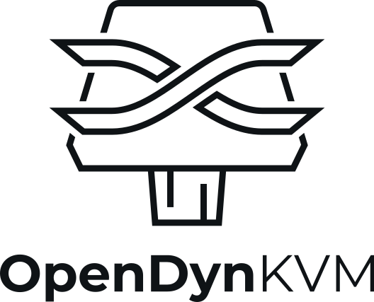
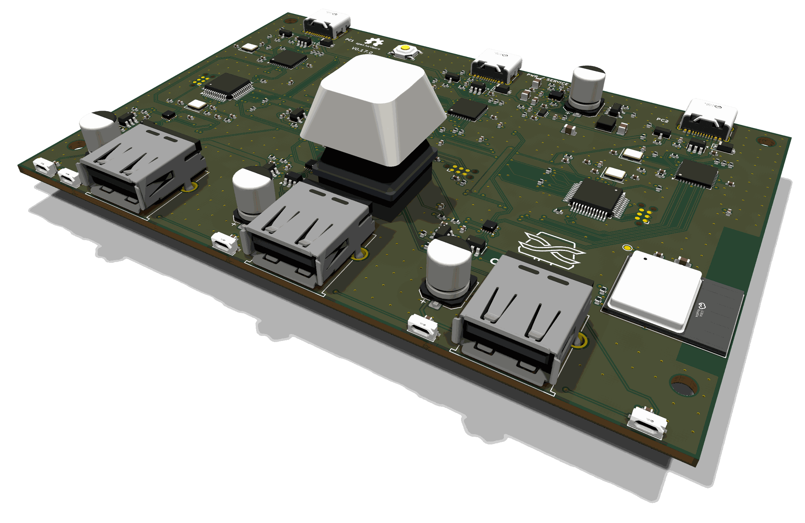

<p align="center">
  <picture>
    <source media="(prefers-color-scheme: dark)" srcset="branding/opendynkvm-logo-on-dark.svg">
    
  </picture>
</p>

<p align="center">
  
</p>

# OpenDynKVM

An open-source USB KVM switch for two PCs that switches in under a millisecond. Each PC is permanently connected to a
keyboard, mouse and "other" device emulated by the KVM ("persistent emulation"), so a switch only changes where the
reports go: no PC sees a disconnect, nothing re-enumerates, and High-Speed USB on the PC side adds about 0.1 ms of
latency. Devices that cannot be emulated (webcams, flash drives) go straight to a PC in passthrough mode. Keyboards
without their own remapping can be remapped on the KVM with the Vial app.

- **Back:** USB-C to PC1, USB-C to PC2, USB-C power/service port (optional power, firmware recovery).
- **Front:** USB-A for keyboard, mouse and one other device; a mechanical key (tap = switch PC) with an RGB LED; status
  LEDs per PC and per port.
- **Inside:** an RP2354B (USB host for the front ports, all switching logic), two AT32F405 (one High-Speed USB device per
  PC), three USB 2.0 hubs and a 1:3 analog USB switch per front port.

**Status (2026-11-12):** the first boards, hardware 0.12.0, run firmware 0.1.10. Hardware 0.17.0, with the fixes from
their bring-up, is designed but not ordered yet. What has been verified on a board and what has not:
[DEVELOPMENT.md](DEVELOPMENT.md#bring-up-status).

## Documentation

| | |
|---|---|
| [`specs.md`](specs.md) | What the KVM does, in numbers |
| [`design.md`](design.md) | How the hardware works and why: block diagram, port modes, components, power, PCB |
| [`software.md`](software.md) | How the firmware and the host software work: protocols, updates, Vial, Bluetooth, screen hop |
| [`DEVELOPMENT.md`](DEVELOPMENT.md) | Building the firmware and the host software, changing the board, bring-up status |
| [`hardware/jlcpcb.md`](hardware/jlcpcb.md) | Ordering the board from JLCPCB |
| [`hardware/errata.md`](hardware/errata.md) | Faults of boards already ordered, their workarounds and fixes |

## Getting a board

There are no boards for sale. The board is ordered assembled from JLCPCB with the files in [`hardware/`](hardware/):
[hardware/jlcpcb.md](hardware/jlcpcb.md) lists every setting of the quote form. Only the MX key switch is plugged into
its socket by hand. The Bluetooth module is optional (boards from 0.16.0): a BOM without it is included.

A 3D-printable case (a tray, a lid with the logo, four spacers and four M3 screws) is in
[`hardware/case/`](hardware/case/), with how to print and assemble it.

## First start of a new board

The chips arrive blank. A USB-C cable is all it takes ([design.md §10](design.md)):

1. Connect a computer to the **PWR/SERVICE** port. A blank RP2354B starts its ROM bootloader and an `RP2350` drive
   appears. (On a board that has firmware, hold the pinhole button while plugging in.)
2. In the app's *Firmware* page, *Set up* (or `odkvmctl update`): it recognises the new board and installs the shipped
   `kvm-first.uf2`. By hand: copy `kvm-first.uf2` (from a release, or built with `cargo xtask dist`) onto the drive.
   The RP2354B restarts with the firmware.
3. It programs both AT32F405s over their SPI links: a few seconds, during which the PC-side hubs are held in reset.
4. The **self-test** runs: one white LED walks along the chain, then for 5 s each LED shows its result, green = passed,
   blinking red = failed (PC LEDs: that PC's link, hub and AT32F405; port LEDs: the port's power switch; key LED: Hub-0
   and the power readings). `odkvmctl status` shows failures in words.
5. Connect PC1 and PC2 to the rear USB-C ports and the devices to the front. Either PC's port can power the KVM, but a
   USB 2.0 port (500 mA) is not enough; a USB-C charger on PWR/SERVICE covers everything ([design.md §6](design.md)).

**Firmware updates** later come from either PC: the *Firmware* page's *Install*, or `odkvmctl update` (both take the
firmware shipped with the app unless given a file or a release's folder), then press the KVM's key when its LED pulses
white. The new image runs on trial and the old one comes back by itself if it fails; the AT32F405s are reprogrammed
automatically when their image changed. A board whose firmware doesn't come up takes the same over PWR/SERVICE: the
pinhole held while plugging in (or `odkvmctl reboot bootloader`), then *Install* on the page's bootloader card, or
`odkvmctl update` with no KVM on a PC port; or copy `kvm-rp2354.uf2` onto the drive by hand.

### Install the host software

`opendyn-kvm` (window and tray icon) and `odkvmctl` (command line) control the KVM from either PC.

- **Windows:** run `OpenDynKVM-Setup-<version>.exe`. It installs for the current user, without administrator rights,
  to `%LOCALAPPDATA%\Programs\OpenDynKVM` (both programs are there), with a Start menu entry and an uninstaller under
  Apps. "Start with Windows, in the tray" is ticked by default. The installer is not code-signed yet, so SmartScreen
  asks once ("More info" → "Run anyway").
- **Debian, Ubuntu:** `sudo apt install ./opendyn-kvm_<version>_amd64.deb`.
  **Fedora, openSUSE:** `sudo dnf install ./opendyn-kvm-<version>-1.x86_64.rpm` (or `zypper install`).
  Both install the programs, a menu entry and the udev rule that gives the logged-in user access to the KVM and to the
  monitors' DDC/CI, and load the `i2c-dev` module (now and at every boot).
  The packages are not signed yet. Where RPM refuses unsigned packages ("does not verify: no signature", RPM 6 on
  recent Fedora), install it with `sudo rpm -U --nosignature ./opendyn-kvm-<version>-1.x86_64.rpm`.
- **Start with the system:** Settings → This computer → "Start with the system, in the tray" in `opendyn-kvm` (a
  setting of this computer and user: the Run entry on Windows, `~/.config/autostart` on Linux). `opendyn-kvm --tray`
  starts with the tray icon only; starting the program again while it runs opens its window. On GNOME the tray icon
  needs the AppIndicator extension; without it the window opens instead.
- **From source on Linux**, install the udev rule and the module setting once yourself
  ([DEVELOPMENT.md](DEVELOPMENT.md#build-and-test)).

Vial (vial.rocks in the browser, or the Vial app) opens the KVM's Vial interface itself, as the logged-in user. The
packages' udev rule covers it, matched by its interface name "OpenDynKVM Vial" (firmware 0.1.10 on), and opens only that
interface. Without it the interface is root's, and Vial waits at "connecting to device" for good. Vial's own rule
(`59-vial.rules`, from the [Vial manual](https://get.vial.today/manual/linux-udev.html)) works too, matching the KVM by
the `vial:f64c2b3c` in its serial number, but it opens every HID interface of the KVM to the logged-in user, the
keyboard ones included.

Windows needs no drivers.

## Using the KVM

- **Switch PCs:** tap the key on the KVM, double-tap Scroll Lock (the default hotkey, invisible to both PCs), or
  `odkvmctl switch pc1|pc2|toggle`. Keys held during a switch are released on the old PC and stay hidden on the new one
  until you let go.
- **Hotkeys:** `odkvmctl hotkey toggle double:scrolllock`, `odkvmctl hotkey pc1 ctrl+alt+1`, `none` to clear. Or
  press it instead of typing it: `odkvmctl hotkey pc1 learn`, or **Learn** on the GUI's Keyboard page, then the hotkey
  on the KVM's keyboard within 10 s. The KVM itself reads the keys, so it learns exactly what it will recognise, and
  they reach neither PC meanwhile (Alt+F4 closes nothing). It works from the active PC, with a keyboard in Auto,
  Normalized or Mirrored mode; one in Passthrough goes straight to the PC, so no hotkey works on it.
- **Profiles:** a profile sets the mode of all three ports at once. A long press (1 s) on the KVM's key selects the
  next one. The KVM powers up in profile 0, as it loses power only when both PCs are off; `odkvmctl config set
  remember-profile on` makes it power up in the profile last active. Out of the box, profile 0 *work* runs every port
  in auto (emulated, instant switching) and profile 1 *gaming* runs every port in passthrough (the real devices, about
  1 s per switch). `odkvmctl profile` lists them,
  `odkvmctl profile next|1|gaming` selects one, `odkvmctl profile 1 name games` renames it,
  `odkvmctl profile 1 mouse mirrored` changes a mode, and `odkvmctl config set profiles 1-4` sets how many are in use.
  The GUI has them on the Ports page and in the sidebar. In passthrough the KVM can't see the keyboard, so the hotkey
  doesn't switch there: use the key or the software.
- **The key's actions:** `odkvmctl config set key-tap|key-long toggle-pc|next-profile|other-port|none` and
  `odkvmctl config set long-press-ms 800-3000` (GUI: Keyboard page). By default a tap switches PCs and a 1 s long
  press selects the next profile.
- **Port modes** (`odkvmctl port keyboard|mouse|other mode <mode>`, which changes the active profile):

  | Mode | What the PCs see | Use it for |
  |---|---|---|
  | `auto` (default) | picks one of the below per device | almost everything |
  | `normalized` | the KVM's own keyboard/mouse | ordinary keyboards and mice; switching is seamless |
  | `mirrored` | the device's own HID interfaces, copied | extra buttons, dials, gamepads |
  | `identity` | as mirrored, plus the device's VID/PID and name | the device maker's own configuration software on the active PC |
  | `passthrough`, `passthrough-pc1`, `passthrough-pc2` | the real device on that PC's hub | webcams, storage, firmware updates of a device |

  Mirrored devices share 3 USB endpoints, one per HID interface (2 with Vial on). While the keyboard and the mouse
  are both mirrored, the KVM gives up its own keyboard and mouse interfaces for them, and they share 6 (5). A device
  that doesn't fit runs normalized where it can, otherwise passthrough; `odkvmctl status` and the GUI say why.

  After swapping the device on a passthrough port, run `odkvmctl port <port> redetect`.
- **Settings:** `odkvmctl config get`, `odkvmctl config set <name> <value>`, `odkvmctl config save` (they are also saved 5 s
  after the last change), `odkvmctl config reset`. The GUI has the same on its settings page.
- **Software control:** switching and configuration from software can be turned off, from either PC
  (`odkvmctl config set software-switching|software-config off`, or Settings → Software control, after an "are you
  sure"). Turning one back on needs the key on the KVM: ask for it (`… on`, or tick it in the GUI), then tap the key
  within 30 s while its LED pulses white; or hold the key while powering the KVM up, which turns both back on.
- **Diagnostics:** `odkvmctl diag`, or the GUI's Firmware page, shows what the KVM measures: its clocks, voltages,
  temperatures and USB link speeds, each marked good, warning (orange) or bad (red). Hover over a reading in the GUI
  for its limits; *Copy* gives the text for a bug report. Details: [software.md §8.4](software.md).
- **Other:** `odkvmctl watch` (events), `odkvmctl identify` (blink the LEDs), `odkvmctl list` (KVMs this PC sees).
- **PCs off or asleep:**
  - The KVM follows the PC that is on: when the active PC is switched off, the other one becomes active (and the
    monitors follow, if set up below).
  - After 10 s without any PC using it, the KVM goes into standby: LEDs dark, front ports off.
  - While the active PC sleeps, the keyboard and mouse stay powered, and a key press wakes the PC; that key isn't
    typed.
  - A PC that turns on, or a press on the KVM's key, ends standby.
  - Settings: `odkvmctl config set auto-select|standby-wake|standby-glow on|off` (glow: the key LED breathes instead
    of going dark), or in the GUI under Settings. Details: [software.md §4.12](software.md).

The LED colours are described in [design.md §7](design.md).

**Key blinking red:** a part of the KVM doesn't work. The PC LEDs show which side; `odkvmctl status` (or the GUI)
says what, and `odkvmctl diag` shows the readings behind it. If it says the KVM gave up programming a PC-side chip or
the Bluetooth module (it stops after 5 failed attempts in a row, so as not to reprogram it at every power-up), try
again with `odkvmctl reboot at32-retry` (or `wireless-retry`), the GUI's "Try again" on the Firmware page, or by holding the
key while plugging the KVM in.

### Monitors follow the KVM (DDC/CI)

The KVM switches USB; the monitors can switch along, over DDC/CI from the PC (MCCS VCP 0x60, input source). No video
passes through the KVM.

1. Turn DDC/CI on in each monitor's own menu.
2. In `opendyn-kvm`, **Displays** lists the monitors that answer, with the input each shows now. For each monitor,
   choose the input that shows PC1 and the one that shows PC2. "Use current" takes the input the monitor shows now (for
   this PC); "Show PC1" / "Show PC2" tries one. Inputs the monitor doesn't list can be typed in hex.
3. Then choose, for each of the KVM's profiles, what the monitor does: **follows the KVM**, **stays on PC1**, **stays on
   PC2**, or **not switched**. For example: in *work* both monitors follow, in *gaming* the left one stays on the
   gaming PC and the right one is left alone.
   With the Bluetooth module, each paired host can have an input too (optional), for a laptop or tablet wired to the
   monitor as well: a monitor that follows the KVM shows it while that host has the keyboard and mouse. A host without
   one leaves the monitor on the PC.
4. From then on, every switch (key, hotkey or software) and every change of profile sets those monitors to the input
   they should show; a monitor already right isn't sent anything. It is a setting of this computer and user
   (`~/.config/opendyn-kvm/settings.json`, `%APPDATA%\OpenDynKVM\settings.json`) and works while `opendyn-kvm` runs,
   in the window or the tray. A monitor set up before profiles follows the KVM in every profile.

The KVM tells **both** PCs about every switch and change of profile, so **set each monitor up on one PC** if you can.
The two PCs don't share these settings: a monitor set up on both gets every command twice (some monitors blank for a
moment, or don't answer the second one while they switch), and if the two set-ups differ it follows neither.

One PC is enough when that PC still reaches the monitor while the monitor shows the other PC. Most monitors answer
DDC/CI on every connected input; some only on the one they show. To tell, use "Show PC1" / "Show PC2" to switch the
monitor away from this PC and back. If it doesn't come back, set it up the same way on both PCs (each then switches it
away from itself), or switch it with the monitor's own button. A monitor connected to only one PC can always be switched
from that PC.

`odkvmctl display` lists the monitors (id, inputs, current input); `odkvmctl display input <id> <value>` sets one, for
scripts. On Linux the monitors are found through `/sys/class/drm` (DisplayPort AUX or the connector's DDC bus), on
Windows through the monitor API (dxva2); laptop panels have no DDC/CI.

### Screen hop: one mouse across both PCs' screens

With screen hop the KVM moves the pointer itself, across both PCs' screens as they stand on the desk, and switches to
the other PC (keyboard and all) when you push the pointer across an edge onto one of its screens. No software is
needed on the PCs; the KVM's mouse gets an absolute pointer for it.

1. In the GUI's *Screen hop* page, turn on **Absolute pointer** (`odkvmctl config set abs-pointer on`). Both PCs
   reconnect the KVM's devices once.
2. Arrange the screens: on each PC, *Detect this computer's screens* (`odkvmctl screens detect`) puts its screens in
   with their resolution, scaling and place in its display settings; then drag them where they stand. Or add them by
   hand (`odkvmctl config set screen0 "pc1 2560x1440 at 0,0"`).
   A monitor cabled to both PCs appears for each of them. On the PC that doesn't show it, untick **Screen hop goes
   onto it** and lay it on the other PC's screen: the pointer then passes to the other PC there, and its own PC still
   counts it, so the pointer lands in the right place on that PC's other screens. When a PC's display settings
   change, the page says so; detect its screens again (screens already there keep their place).
3. Tick screen hop in the profiles that should use it (`odkvmctl config set profile0-hop on`). It needs the Mouse port
   in Normalized mode (Auto picks it for most mice); a profile without it gives games the ordinary relative mouse.

The pointer passes where the same PC's screens meet. Toward the other PC an edge holds it until it is pushed about
100 pixels further (*Edge resistance*), never in the corners, never while a button is held. The PCs don't accelerate an
absolute pointer, so the KVM does: Windows' precision curve, libinput's adaptive curve, or flat, with a speed setting.

Windows puts an absolute pointer on its main screen only. The KVM reaches its other screens with relative motion, which
Windows accelerates: turn off "Enhance pointer precision" on such a PC for exact edges, or keep `opendyn-kvm` running
there (it tells the KVM where the cursor came to rest). `odkvmctl screens` shows the arrangement and the settings.

### Keymap with Vial

- **A keyboard with Vial or VIA of its own** keeps its keymap in the keyboard: set its port to `passthrough`, configure
  it with its app, and set the port back to `auto`. The remapped keys reach the KVM as normal key presses.
- **Any other keyboard** can be remapped on the KVM:
  1. `odkvmctl config set vial auto` (or "Vial interface: Auto" in the GUI). Both PCs detect the KVM again, about 1 s.
     `auto` shows the interface only while no mirrored device needs its USB endpoint; `on` keeps it always.
  2. Open the [Vial](https://get.vial.today) app (desktop, or vial.rocks in a Chromium browser) and pick "OpenDynKVM".
     Choose ANSI or ISO under Layout, then remap keys and layers as on any Vial keyboard.
  3. Macros and the matrix tester ask to **unlock**: hold both Shift keys for 3 s.
  4. Changes are saved 5 s after the last edit. The keymap keeps working with the interface off
     (`odkvmctl config set vial off`); `odkvmctl config set keymap off` bypasses it.
- Supported: 8 layers (MO, TG, TO, DF, OSL, LM, tri-layer), modded keys, mod-tap and layer-tap (tapping term,
  permissive hold, hold on other key press), one-shot modifiers, media, system and mouse keys, 16 macros. Not yet: tap
  dance, combos, key overrides. The keymap applies to keyboards in `normalized` mode, and the KVM sees what the keyboard
  sends, so a keyboard's own Fn key cannot be remapped. Details: [software.md §4.11](software.md).

## Known issues

Board faults with a workaround are listed in [hardware/errata.md](hardware/errata.md). The 0.12 board has three:
- **E1:** D+/D− are crossed between the RP2354B and Hub-0, and the firmware swaps them back. Fixed in copper since the
  0.15.0 design.
- **E2:** the `RP2350` drive appears on PWR/SERVICE only with `SVC_SEL` held high by hand (R510 bridged, or replaced
  by 10k), because R510's 100k loses to the RP2350's pad pull-down. Updates over a PC port don't need it. Fixed in
  the 0.17.0 design.
- **E3:** the five side LEDs shine into the board instead of out of the front edge. Fixed in the 0.17.0 design.

Not yet tried on a board: the Bluetooth module, standby with remote wakeup, switching monitor inputs over DDC/CI, and
the AT32F405 recovery paths; the full list is in [DEVELOPMENT.md](DEVELOPMENT.md#bring-up-status). The Windows installer
and the Linux packages are not signed yet.

## Licensing

- **Hardware:** [CERN-OHL-S v2](LICENSES/CERN-OHL-S-2.0.txt): the board, the scripts that hold its design
  (`gen_symbols.py`, `gen_footprints.py`, `gen_schematic.py`, `gen_pcb.py`), the fabrication files and the design
  documents. Anyone who makes and distributes boards from a modified design must publish the modified design.
- **Software:** [MIT](LICENSES/MIT.txt) OR [Apache-2.0](LICENSES/Apache-2.0.txt), at your choice: the firmware, the
  crates, odkvmctl, xtask, the logo (`branding/`) and their documentation. The general-purpose hardware tools (router,
  checks, fabrication, solvers) are [MIT](LICENSES/MIT.txt).
- **Third party:** the HRO USB-C footprint comes from the KiCad library ([CC-BY-SA-4.0](LICENSES/CC-BY-SA-4.0.txt) with
  the [KiCad libraries exception](LICENSES/KiCad-libraries-exception.txt)); parts of `crates/kvm-vial` are adapted from
  [RMK](https://github.com/HaoboGu/rmk) ([notice](crates/kvm-vial/LICENSE-RMK-MIT)). The wordmark is set in
  [Montserrat](https://github.com/JulietaUla/Montserrat) (SIL OFL 1.1) and converted to outlines; no font file is
  distributed. The window's text font is [Adwaita Sans](https://gitlab.gnome.org/GNOME/adwaita-fonts) (derived from
  [Inter](https://github.com/rsms/inter); [SIL OFL 1.1](LICENSES/OFL-1.1.txt),
  [notice](software/odkvmctl/fonts/OFL.txt)), cut down by `software/odkvmctl/fonts/make_ui_font.py` and embedded in
  opendyn-kvm; its Chinese text is set in [Noto Sans CJK SC](https://github.com/notofonts/noto-cjk)
  ([SIL OFL 1.1](LICENSES/OFL-1.1.txt), [notice](software/odkvmctl/fonts/OFL-NotoSansCJK.txt)), cut down by
  `make_cjk_font.py` to the characters the translation uses. Datasheets and EasyEDA part data are not distributed.

Every file's license and copyright is listed in [REUSE.toml](REUSE.toml) ([REUSE](https://reuse.software) format).

```
Copyright 2026 Fabian Tschopp.

This source describes Open Hardware and is licensed under the CERN-OHL-S v2.

You may redistribute and modify this source and make products using it under the terms of the CERN-OHL-S v2
(https://ohwr.org/cern_ohl_s_v2.txt).

This source is distributed WITHOUT ANY EXPRESS OR IMPLIED WARRANTY, INCLUDING OF MERCHANTABILITY, SATISFACTORY QUALITY
AND FITNESS FOR A PARTICULAR PURPOSE. Please see the CERN-OHL-S v2 for applicable conditions.

Source location: https://github.com/naibaf7/OpenDynKVM
```
