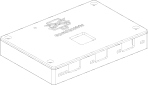

# OpenDynKVM case

A 3D-printable case in three printed parts: a **tray** the board sits in, a flat **lid** with the OpenDynKVM logo
raised over the key, and four **spacers**. Four M3 screws through the lid, the spacers and the board's four mounting
holes hold everything together. It fits every board from 0.12.0 to 0.17.0: their holes, ports, key and LEDs are in
the same places.



| File | What |
|---|---|
| `tray.3mf`, `lid.3mf`, `spacers.3mf` | For the slicer, already in print orientation |
| `case.step` | The assembled case for editing in CAD: exact geometry, one named solid per part, and a simple reference model of the board (not printed) |
| `gen_case.py`, `gen_case.py.lock` | Builds all of the above from `board.json` (Python, [build123d](https://github.com/gumyr/build123d)); the lock pins its environment |
| `board_facts.py` | Writes `board.json`: the board outline, holes, connectors, LEDs, key and every part's footprint, from `../kvm.kicad_pcb` |

## Printing

PLA or PETG, 0.4 mm nozzle, 0.2 mm layers, no supports. Print each part the way it lies in its file:

- **Tray:** standing on its floor. The windows in the walls bridge 13 mm at most.
- **Lid:** flat side down, logo up. For a logo in a second colour: change filament at **2.5 mm** (the logo's first
  layer), or give the part named *logo* its own filament on a multi-material printer. The slicer loads the lid as one
  object with two parts, *lid* and *logo*.
- **Spacers:** standing; all four are in one file.

Size: 125.1 × 85.7 × 20.1 mm, plus the 0.8 mm logo.

## What else it takes

- 4 × M3 heat-set inserts, M3 × 5.7 mm, 4.6 mm across (the posts have 4.0 mm holes; other inserts: `INSERT_D`,
  `INSERT_L` in `gen_case.py`)
- 4 × M3 × 18 countersunk screws (ISO 10642 or DIN 7991). M3 × 16 and M3 × 20 fit too: they reach 2.9 and 6.9 mm
  into the post, against 4.9 mm for the 18 mm screws.
- Optional: four rubber feet.

Without inserts, set `FASTENER = 'tap'` for 2.5 mm pilot holes and self-tapping screws.

## Assembly

1. Press an insert into each corner post with a soldering iron (about 220 °C for PLA), flush with the top.
2. Lay the board in the tray, the USB-C ports to the rear: it drops straight in, and the ports line up with the
   openings.
3. Put a spacer on each mounting hole.
4. Lower the lid over the key: the keycap goes through its cutout (19.6 mm, for an 18 mm keycap) and stands about
   9.5 mm proud of the lid.
5. Screw down the four corners, gently: the screws clamp the board between the posts and the spacers.

The small hole left of the logo is over SW501, the bootloader button: a paper clip reaches it ("hold the pinhole
button while plugging in", [README](../../README.md#first-start-of-a-new-board)). On 0.12.0 boards the five side LEDs
face into the board ([errata E3](../errata.md)), so their windows in the front only glow faintly.

## Changing it

- **By hand:** open `case.step` in [FreeCAD](https://www.freecad.org) (or Fusion, Onshape, SolidWorks); each part is
  a solid of its own, in millimetres. Export the changed part as STEP for further editing and as 3MF or STL for the
  slicer. Running `gen_case.py` again overwrites `case.step` and the 3MF files, so keep hand-edited files under other
  names.
- **By script:** every dimension is a constant at the top of `gen_case.py` (wall and lid thickness, clearances, the
  sizes of the openings, logo width and height, screws). Then, from this folder:

  ```sh
  uv run gen_case.py                       # needs uv (https://docs.astral.sh/uv/); the first run sets up its Python
  uv run gen_case.py --preview /tmp/case   # also line drawings (SVG) of the parts
  ```

  The script lists its own dependencies at its top, pinned by `gen_case.py.lock`, and runs in an environment of its
  own: OpenCascade has no build for every Python that KiCad uses, so it can't share the repository's.

- **After a board change:** run `uv run board_facts.py` (the repository's environment, which reaches KiCad's
  `pcbnew`: [DEVELOPMENT.md](../../DEVELOPMENT.md)), then `uv run gen_case.py`. The script first checks the case against the board and stops with a list if something no longer fits: the
  height of every part above and below the board, the spacers and posts against the parts round each hole, parts
  that overhang the board's edge, the ribs between the openings, the logo against the key cutout, pinhole and
  screws, and how far each screw length reaches into the posts. The part heights it uses are in `TOP_PARTS` and
  `UNDER_PARTS`, from the parts' datasheets; a footprint it doesn't know stops it too.
